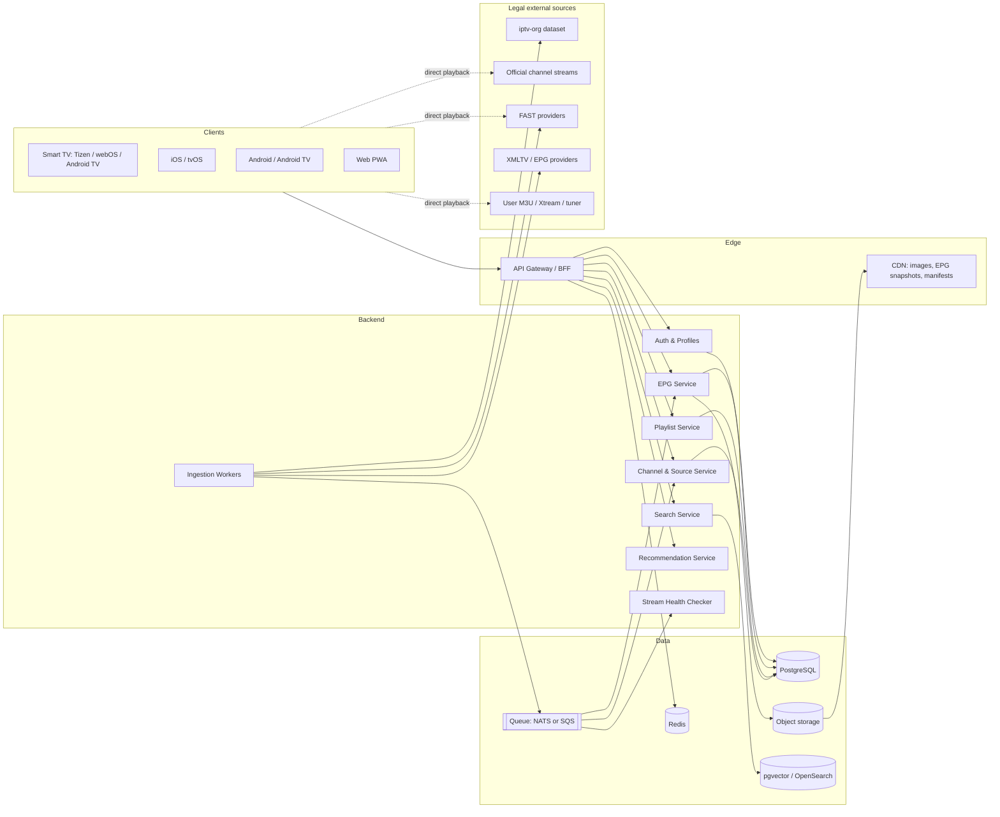
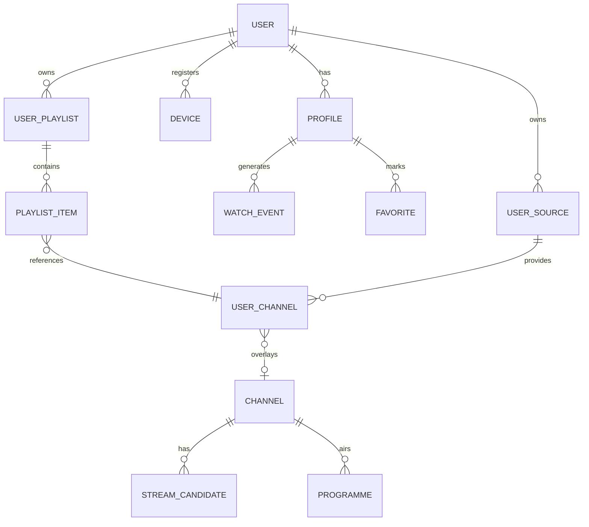

# Global Smart Receiver AI Platform — Architecture

Status: draft v0.1 · Scope: technical foundation for the platform · Companion: [ROADMAP.md](./ROADMAP.md)

> **Note on the repository.** The repo root currently holds an unrelated Vite/React prototype (an Arabic assessment generator). The receiver platform will live in new top-level directories (`apps/`, `services/`, `packages/`, `infra/`) and will not reuse that code. Whether to relocate the prototype is a separate decision.

## 1. Product Summary

A universal TV, IPTV and satellite receiver front-end: one app family that aggregates **legal** live and on-demand sources, unifies their programme guide (EPG), lets users fully manage their own channels and sources, and adds AI-powered search and recommendations.

## 2. Legal Sources Policy (hard constraint)

This is an architectural requirement, not a footnote. The system is designed so that unlawful sources have no code path.

**Supported source classes**

| Class | Examples | Ingestion |
|---|---|---|
| Official free broadcasts published by the channel | Al Jazeera, Sky News Arabia, DW, France 24 | Curated catalog entries (public HLS/DASH URLs) |
| Free ad-supported streaming (FAST) | Pluto TV, Samsung TV Plus, Plex, Tubi (where terms permit) | Curated catalog, per-provider terms respected |
| Open public directories | [iptv-org](https://github.com/iptv-org/iptv) (channels, streams, guides) | Scheduled sync of the public dataset |
| Free-to-air satellite | DVB-S/S2 FTA via user's own tuner or a network tuner (e.g. HDHomeRun, TVHeadend) | Local tuner integration, no decryption |
| User-supplied sources | M3U/M3U8 URLs or files, Xtream Codes credentials, XMLTV URLs the user owns and enters | Per-user, stored encrypted, never shared |

**Explicitly out of scope — not designed, not implemented, not accepted as contributions:**

- Decrypting encrypted/paid channels, card-sharing (CCcam, newcamd, etc.), or any CAM/softcam integration.
- DRM circumvention or key extraction. The player may play DRM content only through the platform's licensed CDM (Widevine/PlayReady/FairPlay) when the *user's own legitimate subscription* provides the license — we never obtain keys ourselves.
- Re-hosting or re-distributing a paid stream from our servers.

**Enforcement mechanisms**

1. **Source registry, not a stream proxy.** The backend stores *metadata and URLs*. Official/FAST/directory streams are played directly from their origin. User-supplied streams are played directly from the user's device to the user's provider; the backend never relays or caches media for them.
2. **No-DRM-bypass invariant.** The player module exposes only platform-licensed DRM. There is no pluggable "clearkey from URL" for encrypted third-party streams.
3. **Provenance flag** on every source (`official | fast | directory | fta | user`) and a takedown path: directory/catalog entries can be disabled globally by a moderator flag (`status = blocked`) if a rights holder objects.
4. **Terms-of-use gate** on user-supplied sources: the user attests ownership/entitlement when adding a playlist or Xtream account. Logged for audit.
5. **Review checklist** in PR template: "does this change add a path to unlicensed content?" must be answered.

## 3. System Overview



Key principle: **clients play streams directly from the source**. The backend is a metadata, guide, identity and intelligence layer, which keeps hosting costs low and keeps us out of media redistribution.

## 4. Frontend

### 4.1 Shared strategy

A monorepo (`pnpm` + Turborepo) with a shared TypeScript core and per-platform shells.

| Platform | Technology | Player | Notes |
|---|---|---|---|
| Web (PWA) | React + Vite + TypeScript, TanStack Query, Zustand | hls.js, dash.js (or Shaka Player for both + DRM) | Also the base for TV web apps |
| Samsung Tizen | Web app reusing the React build, Tizen Studio packaging | AVPlay (native, preferred) with Shaka fallback | Spatial navigation library, 10-foot UI |
| LG webOS | Web app reusing the React build, `ares-cli` packaging | webOS native `<video>` + Shaka | Magic-remote pointer support |
| Android / Android TV | Kotlin, Jetpack Compose (+ Compose for TV), Hilt | Media3 / ExoPlayer (HLS, DASH, Widevine) | Leanback-style navigation, Android TV Channels API |
| iOS / tvOS | Swift, SwiftUI, AVFoundation / AVPlayer (HLS, FairPlay) | AVPlayer | tvOS focus engine; Picture-in-Picture on iOS |

**Alternative to evaluate in Phase 1:** React Native (with `react-native-tvos`) to share more UI between iOS/Android/tvOS/Android TV. Recommendation: start native for the two mobile/TV stores where player quality matters most (Media3, AVPlayer), keep the web build for Tizen/webOS, and share *logic* (API client, models, EPG parsing) through generated OpenAPI clients plus a Kotlin Multiplatform or TS core. Revisit after MVP metrics.

### 4.2 Shared UI modules (all platforms)

- **Live TV grid & channel list** with favourites, groups, number-key zapping.
- **EPG grid** (virtualized, time-axis, now/next), with timezone handling.
- **Player shell**: audio/subtitle tracks, quality selection, error recovery, retry on dead streams, fallback to alternate source for the same channel.
- **Channel & source manager** (the user-control surface): add/remove/reorder channels, edit name/logo/group/EPG-mapping, create custom playlists, import/export M3U, add/edit/remove sources (M3U URL, Xtream account, tuner), per-source enable/disable, bulk edit. Works offline-first and syncs.
- **AI search & recommendations** surface (voice and text).
- **Profiles, parental controls, settings.**
- **i18n/RTL from day one**: Arabic and English, full RTL layout support, Arabic-aware search (normalization of diacritics/alef variants).

### 4.3 10-foot UX rules

Focus-driven navigation only (no hover dependencies), minimum 48px focus targets on TV, overscan-safe margins, remote-key mapping layer (`RCU` abstraction for D-pad, Back, number keys, colour keys, media keys), and a performance budget of ≤2 s cold start to first channel on mid-range TVs.

## 5. Backend

### 5.1 Technology

- **Language/runtime:** TypeScript on Node.js 22 with **NestJS** (or Fastify) for the API; **Python 3.12 (FastAPI)** for AI/ML workers. Go is an option for hot-path ingestion/health-check workers if throughput demands it.
- **API style:** REST + OpenAPI 3.1 (source of truth, generates all client SDKs). GraphQL deliberately avoided at MVP.
- **Database:** PostgreSQL 16 (primary), **pgvector** for embeddings, Redis for cache/rate limits/sessions.
- **Queue/Jobs:** NATS JetStream or SQS + BullMQ for scheduled syncs.
- **Object storage:** S3-compatible (EPG snapshots, logo cache, import files).
- **Infra:** Docker, Kubernetes (or ECS/Fly.io for MVP), Terraform, GitHub Actions CI/CD, OpenTelemetry + Grafana/Prometheus/Sentry.

### 5.2 Services

Start as a **modular monolith** with clear module boundaries; split when load demands.

| Module | Responsibility |
|---|---|
| **Auth & Profiles** | Sign-up/in (email+password, Apple/Google, device-code login for TVs), OIDC (Keycloak or Auth0/Clerk), short-lived JWT + refresh tokens, multi-profile per account, device registry |
| **Channel & Source Service** | Canonical channel catalog + per-user overlays. Sources (official, FAST, directory, FTA, user). CRUD with ownership enforcement. |
| **Playlist Service** | Parse/validate M3U/M3U8/Xtream; user playlists, folders, ordering; import/export; share *metadata-only* lists between a user's own profiles |
| **EPG Service** | Aggregate XMLTV and provider guides, normalize, map to channels, serve now/next and windowed grids |
| **Ingestion Workers** | iptv-org sync, official/FAST catalog sync, XMLTV fetch, logo fetch, scheduled and on-demand |
| **Stream Health Checker** | Probes stream URLs (HEAD/manifest fetch), marks dead/slow, drives fallback-source selection. Does not store media. |
| **Search Service** | Hybrid lexical + semantic search (see §7) |
| **Recommendation Service** | Personalized rows and "similar channels/programmes" (see §7) |
| **Sync Service** | Per-device state sync (favourites, order, last watched, edits) via versioned change log |
| **Admin/Moderation** | Catalog moderation, takedown flags, abuse review |

### 5.3 Core API surface (illustrative)

```
POST   /v1/auth/device-code            # TV pairing
GET    /v1/me/channels                 # merged view: catalog + user overlays
POST   /v1/me/channels                 # create custom channel
PATCH  /v1/me/channels/{id}            # edit name/logo/group/epg mapping/order
DELETE /v1/me/channels/{id}
GET    /v1/me/sources                  # user sources
POST   /v1/me/sources                  # add M3U URL / Xtream / tuner (with ownership attestation)
PATCH  /v1/me/sources/{id}             # edit / enable / disable
DELETE /v1/me/sources/{id}
POST   /v1/me/playlists/import         # M3U file or URL
GET    /v1/me/playlists/{id}/export.m3u
GET    /v1/epg/grid?channels=…&from=…&to=…
GET    /v1/epg/now-next?channels=…
GET    /v1/search?q=…
GET    /v1/recommendations?profile=…
```

### 5.4 Security and privacy

- User-supplied credentials (Xtream user/password, tokenised M3U URLs) are **encrypted at rest** (envelope encryption, KMS-managed keys) and decrypted only when handed to the owning user's device or the health checker acting on their behalf. Never logged.
- Strict per-user tenancy (row-level security in Postgres).
- Rate limiting, input validation, SSRF protection on any server-side URL fetch (block private ranges, enforce size/time limits, scheme allow-list).
- Privacy: viewing history is per-profile, exportable and deletable (GDPR/UAE PDPL-aware). AI features use pseudonymous IDs.
- Parental controls enforced server-side for catalog metadata and client-side at playback.

## 6. Streaming Pipeline

### 6.1 Playback

- **Formats:** HLS (primary), MPEG-DASH, progressive MP4 for VOD. Raw MPEG-TS URLs supported where the platform player allows (ExoPlayer, AVPlay).
- **Direct-to-origin playback.** The client resolves the best source for a channel (health score, user priority, region) and plays from the origin. The backend returns a ranked list of candidate URLs for failover.
- **Adaptive bitrate** handled by the player from the origin's own ladder.
- **Native tuner path (FTA):** Android TV with USB/built-in DVB tuner via the platform TV Input Framework; network tuners via HDHomeRun / TVHeadend / SAT>IP exposed as an M3U/HLS endpoint on the user's LAN. FTA only: no CA module support.

### 6.2 Ingestion

```
Source (M3U / Xtream / iptv-org / XMLTV)
   → Fetch (SSRF-safe, size/time limited)
   → Parse (M3U8 tags: tvg-id, tvg-name, tvg-logo, group-title; Xtream player_api JSON)
   → Normalize (names, languages, countries, categories)
   → Deduplicate (tvg-id, normalized name + country, stream-URL hash)
   → Validate (manifest probe, codec/bitrate sniffing, geo hint)
   → Persist (channels, sources, stream_candidates)
   → Emit events (EPG mapping, search indexing, health scheduling)
```

- **M3U:** tolerant parser (extended attributes, `#EXTVLCOPT` headers ignored unless benign such as `http-user-agent`).
- **Xtream Codes:** call the user's own provider API (`player_api.php`) *from the user's device or on their behalf*, map live/VOD/series categories to channels. Credentials remain user-owned.
- **iptv-org:** nightly sync of `channels.json`, `streams.json`, guides; respect their metadata (`blocklist`, `closed` flags) and licence.

### 6.3 Transcoding considerations

Default stance: **we do not transcode third-party streams.** Reasons: legal exposure, cost, latency. Where transcoding is justified:

- **Our own content only** (e.g. future first-party or partner channels): FFmpeg/GStreamer or managed (AWS MediaLive/MediaConvert, Mux) producing HLS CMAF ladders (e.g. 1080p/720p/480p/360p, H.264 + AAC; HEVC where devices support it).
- **Client-side compatibility shims** instead of server transcode: codec capability probing on device, audio-track selection (e.g. prefer AAC/AC-3 fallback), container remux in-player where supported.
- **Thumbnails/previews:** generated by the health checker from official/FAST/directory streams only, never from user-supplied streams.

### 6.4 Health, failover and quality

- Probe cadence by tier (official/FAST: 15 min; directory: hourly; user sources: on-demand + on-launch).
- Stream score = f(availability, startup latency, bitrate, rebuffer telemetry from clients).
- Player-side QoE telemetry (startup time, rebuffer ratio, errors) feeds the scores and the dashboard.

### 6.5 EPG pipeline

```
XMLTV / provider guide / iptv-org guides
   → Fetch & cache (conditional GET, gzip)
   → Parse (streaming XML parser)
   → Normalize time zones (store UTC + source TZ), titles, categories, ratings
   → Map programme-channel via tvg-id → fallback fuzzy match (name+country) → manual user mapping
   → Merge with priority (official > provider > community)
   → Store (Postgres, partitioned by day) + publish compact JSON snapshots to CDN
```

Users can override EPG mapping per channel (and add their own XMLTV URL), so the guide stays correct for edited channels.

## 7. AI Features

### 7.1 Smart search

- **Hybrid retrieval:** Postgres full-text / OpenSearch (BM25) + embeddings (pgvector) over channel names, descriptions, programme titles/synopses, categories, languages.
- **Natural-language queries** ("Arabic news live now", "football tonight", "kids cartoons in English"): an LLM parses intent into structured filters (language, country, genre, live-now, time window), then runs hybrid retrieval and reranks.
- **Arabic-first NLP:** normalization (diacritics, alef/ya/ta marbuta variants), transliteration matching ("الجزيرة" ↔ "Al Jazeera"), embeddings from a multilingual model (e.g. `bge-m3`, `multilingual-e5`, or a hosted embeddings API).
- **Voice search** via platform speech APIs (Android SpeechRecognizer, iOS Speech, Tizen/webOS voice where available) feeding the same pipeline.
- **Guardrails:** retrieval only over legal catalog + the user's own sources; the LLM never invents streams or URLs.

### 7.2 Recommendations

- **Signals:** watch time per channel/programme/genre, favourites, explicit likes, time-of-day patterns, profile language.
- **Models (staged):**
  1. MVP: rules + popularity + content-based similarity (embedding nearest neighbours).
  2. Phase 3: implicit-feedback collaborative filtering (e.g. ALS / LightFM) blended with content embeddings; contextual re-rank (time of day, device).
  3. Later: LLM-generated explanations ("because you watch Al Jazeera English").
- **Surfaces:** "Continue watching", "On now for you", "Similar channels", "Discover new free channels".
- **Privacy:** per-profile opt-out, on-device-only mode option, no cross-user sharing of user-supplied source information.

### 7.3 Other AI utilities

- **EPG auto-mapping:** embeddings + fuzzy matching to suggest channel↔guide links for user playlists.
- **Playlist cleanup:** detect duplicates, mislabeled groups, dead links; propose fixes the user accepts or rejects (user stays in control).
- **Programme summaries/translation** (Arabic ↔ English) for guide text.

### 7.4 AI infrastructure

Python workers (FastAPI), model access behind an internal gateway (hosted LLM API for query understanding; open embedding model self-hosted or hosted), embeddings stored in pgvector, offline training/eval jobs on a schedule, evaluation sets for Arabic and English queries, cost and latency budgets per request (target p95 search < 400 ms excluding LLM-parse path, which is cached).

## 8. Data Model

Core entities (PostgreSQL). `user_id` scoping and row-level security apply to all `user_*` tables.



| Table | Key fields |
|---|---|
| `users` | id, email, auth_provider, created_at, locale |
| `profiles` | id, user_id, name, language, parental_level, ai_opt_in |
| `devices` | id, user_id, platform, model, last_seen |
| `channels` (catalog) | id, slug, name, name_ar, country, languages[], categories[], logo_url, tvg_id, provenance (`official/fast/directory/fta`), status (`active/blocked/closed`), embedding vector |
| `stream_candidates` | id, channel_id, url, protocol (`hls/dash/ts`), drm_required, region_hint, health_score, last_checked_at |
| `programmes` | id, channel_id, start_utc, end_utc, title, description, category, rating, lang, source_id |
| `epg_sources` | id, name, url, priority, last_fetched_at |
| `user_sources` | id, user_id, type (`m3u_url/m3u_file/xtream/xmltv/tuner`), name, enabled, config_encrypted, ownership_attested_at, last_sync_at |
| `user_channels` | id, user_id, source_id?, catalog_channel_id?, custom_name, custom_logo, group_id, sort_order, hidden, epg_channel_id_override, stream_url_encrypted? |
| `user_groups` | id, user_id, name, sort_order |
| `user_playlists` / `playlist_items` | id, user_id, name; playlist_id, user_channel_id, position |
| `favorites` | profile_id, user_channel_id/channel_id, created_at |
| `watch_events` | id, profile_id, channel_id/programme_id, started_at, duration_s, device_id (retention-limited) |
| `change_log` | id, user_id, entity, entity_id, op, version, payload, ts — drives multi-device sync |
| `audit_log` | id, actor, action, subject, ts — source attestations, moderation actions |

**Overlay model:** the catalog is shared and read-only to users; user edits are stored as overlays (`user_channels`) so users get full editing control (rename, regroup, reorder, hide, remap EPG, replace the stream URL with their own) without mutating shared data, and catalog updates still flow in.

## 9. Cross-Cutting Concerns

- **Testing:** unit (Vitest/Jest, JUnit/XCTest), contract tests from OpenAPI, ingestion fixtures (malformed M3U corpus), player E2E on real devices/emulators, load tests (k6) for EPG grid endpoints.
- **Observability:** structured logs, traces, client QoE metrics, SLOs (API availability 99.9%, EPG freshness < 6 h, search p95 < 400 ms).
- **CI/CD:** GitHub Actions, per-PR preview of web, store pipelines via fastlane (iOS/Android), Tizen/webOS packaging jobs.
- **Accessibility:** screen-reader labels, focus visibility, caption support, high-contrast theme.
- **Localization:** ICU message format, RTL snapshot tests.

## 10. Proposed Repository Layout

```
apps/
  web/            # React PWA (also packaged for Tizen & webOS)
  tizen/  webos/  # thin packaging shells
  android/        # Kotlin, Compose (phone + TV)
  ios/            # Swift, SwiftUI (iPhone, iPad, tvOS)
services/
  api/            # NestJS modular monolith
  workers/        # ingestion, EPG, health checks
  ai/             # FastAPI: search parsing, embeddings, recommenders
packages/
  api-spec/       # OpenAPI source of truth + generated SDKs
  core/           # shared TS logic: M3U parser, EPG model, remote-key map
infra/            # Terraform, Docker, K8s manifests
docs/             # ARCHITECTURE.md, ROADMAP.md, ADRs
```

## 11. Open Decisions (to record as ADRs)

1. Native vs React Native for mobile/TV shells.
2. Hosted auth (Auth0/Clerk) vs self-hosted Keycloak.
3. Search backend: Postgres+pgvector only vs OpenSearch.
4. Cloud target for MVP (Fly.io/Render vs AWS).
5. Policy for FAST providers whose terms restrict third-party apps (default: include only where terms allow; otherwise deep-link to the official app).
